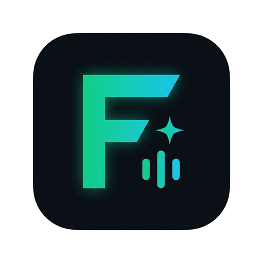

<div align="center">
  

# FREECLUELY

**Free, source-available AI interview copilot & meeting assistant.**
<br/>
**Use your own API keys (Gemini, OpenAI, Claude, Groq, DeepSeek, OpenRouter) — or run 100% free & offline with Local Llama (Ollama) with no API key required.**

<br/>

[](LICENSE)
[](https://github.com/Stanley03-arch/FREECLUELY/releases/latest)
[](https://github.com/Stanley03-arch/FREECLUELY/releases/latest)
[](https://github.com/Stanley03-arch/FREECLUELY)

---

## Download FREECLUELY for Free

<p align="center">
  <a href="https://github.com/Stanley03-arch/FREECLUELY/releases/latest/download/FREECLUELY-Setup-3.2.1.exe">
    
  </a>
  &nbsp;
  <a href="https://github.com/Stanley03-arch/FREECLUELY/releases/latest">
    
  </a>
  &nbsp;
  <a href="https://github.com/Stanley03-arch/FREECLUELY/releases/latest">
    
  </a>
</p>

<p align="center">
  <a href="#phone-mirror-ios--android">
    
  </a>
  &nbsp;
  <a href="#phone-mirror-ios--android">
    
  </a>
</p>

<p align="center">
  <a href="https://ollama.com/download">
    
  </a>
</p>

<small>Desktop installers: Windows 10/11 (`.exe`), macOS 12+ Apple Silicon & Intel (`.dmg` / `.zip`), Linux (`.AppImage` / `.deb`). Mobile: iOS & Android connect via built-in Phone Mirror.</small>

</div>

---

## Bring Your Own API Key — Or Use Free Local Llama

FREECLUELY never locks you into a paid subscription:

1. **Bring Your Own API Key (BYOK):**
   Open **Settings → AI Providers** and paste your key for **Google Gemini**, **OpenAI**, **Anthropic Claude**, **Groq**, **DeepSeek**, **OpenRouter**, **Nvidia NIM**, or any custom endpoint.
2. **No API Key? Use Free Local Llama (Ollama):**
   - Click **Download Free Llama** above (or inside **Settings → AI Providers**).
   - Pull a free Llama model:
     ```bash
     ollama pull llama3.2
     ```
   - Select `llama3.2 (Local)` in **Settings → AI Providers** — 100% free, unlimited, and completely offline.

---

## Key Features

- **Real-Time Meeting & Interview Assistance:** Listens to system audio and microphone with ultra-low latency and answers questions in real time.
- **On-Device Speech-to-Text:** Supports local Whisper / Moonshine / Parakeet ONNX models and Apple Speech — no cloud audio fees.
- **Stealth Mode:** Optional screen-share hiding, taskbar/dock hiding, and discreet overlay controls.
- **Visual Answers & Diagrams:** Generates system design diagrams, flowcharts, and code explanations directly in the overlay.
- **Local RAG & Memory:** Stores transcripts and notes locally on your device with SQLite vector search and PDF/DOCX/TXT reference file support.
- **9 Built-in Modes:** Technical Interview, General, Sales, Recruiting, Team Meet, Lecture, Seminar, Call Center, plus custom modes.

---

## Phone Mirror (iOS & Android)

FREECLUELY is a desktop application (Windows, macOS, Linux) with a built-in **Phone Mirror** web companion for mobile devices:
1. Open **Settings → Phone Mirror** in the desktop app.
2. Scan the QR code with your **iPhone (iOS Safari)** or **Android (Chrome)** device.
3. View live transcripts, streaming AI answers, and send photos straight back to your desktop — no App Store or Play Store install required.

---

## Build from Source

```bash
git clone https://github.com/Stanley03-arch/FREECLUELY.git
cd FREECLUELY
npm install
npm run app:dev
```
